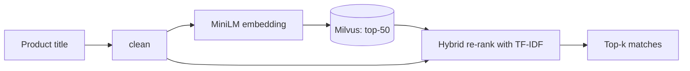
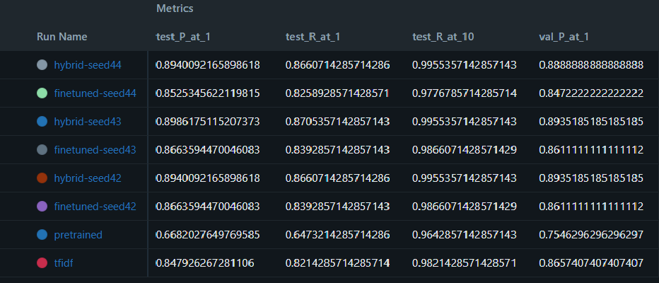

# Product Matching: Hybrid Embedding + TF-IDF Retrieval


Cross-store product matching (entity resolution) on the Abt-Buy benchmark.
Given a product title from one store, the service returns the most likely
matching products from another store's catalog.

## Approach

1. **Baseline:** character n-gram TF-IDF (strong on model codes like `PS-LX350H`).
2. **Pretrained embeddings** (`all-MiniLM-L6-v2`): semantic, but weak on model codes.
3. **Fine-tuning:** contrastive learning (MultipleNegativesRankingLoss) on 656 labeled pairs.
4. **Hybrid score:** `0.5 * embedding_cosine + 0.5 * tfidf_cosine` (alpha chosen on validation).
5. **Serving:** Milvus (HNSW, cosine) retrieves top-50 candidates by embedding,
   then TF-IDF re-ranks them with the hybrid score. FastAPI exposes `/match` and `/health`.



## Results

Split by Abt product (train 648 / val 216 / test 217). Model and alpha were chosen
on validation; the test set was evaluated once. Fine-tuning and hybrid rows are the mean ± std
over 3 training seeds.

| Method (test) | R@1 | R@5 | R@10 | P@1 |
|---|---|---|---|---|
| TF-IDF char n-gram | 0.821 | 0.960 | 0.982 | 0.848 |
| Pretrained MiniLM | 0.647 | 0.906 | 0.964 | 0.668 |
| Fine-tuned MiniLM | 0.835 ± 0.008 | 0.970 | 0.984 | 0.862 ± 0.008 |
| **Hybrid (alpha=0.5)** | **0.868 ± 0.003** | **0.976** | **0.996** | **0.896 ± 0.003** |

Hybrid validation P@1 was 0.892, consistent with test (0.896).

**Takeaways**
- Off-the-shelf embeddings lose to TF-IDF because they blur model codes.
- Fine-tuning closes most of the gap (+19 P@1 points over pretrained) but only matches TF-IDF on its own.
- The gain comes from combining the two: they make different errors.
- Milvus (approximate HNSW, top-50 candidates) matched exact numpy search on validation (identical P@1/R@1).

**Limitations**
- Std covers training seeds only. The data split is fixed and the test set is small (217 products,
  ~±2 points sampling uncertainty), so the +4.8 P@1 gain over TF-IDF is likely real but not proven.
- Single dataset, product `name` field only, small catalog (1,092 products).

## Experiment tracking



## Latency

200 sequential requests (after 20 warm-up), top_k=5, CPU container, Windows + Docker Desktop,
1,092-product catalog. Single-user latency, not a throughput benchmark.

| | p50 | p95 |
|---|---|---|
| End-to-end | 60.7 ms | 69.2 ms |
| Server-side | 15.8 ms | 24.6 ms |

## Run it

```bash
python -m venv .venv && .venv\Scripts\activate
pip install -r requirements.txt
python -m src.training.finetune          # train
python -m src.matching.index_milvus      # index catalog into Milvus

docker compose -f milvus-compose.yml up -d
docker compose up --build api
```

```bash
curl -X POST http://127.0.0.1:8000/match -H "Content-Type: application/json" \
     -d '{"title": "Sony Turntable PSLX350H", "top_k": 3}'
```

Data (Abt-Buy CSVs) is not included; place it in `data/`.

## Stack

Python, Sentence-Transformers, PyTorch, scikit-learn, Milvus, FastAPI, MLflow (SQLite),
Docker Compose, pytest, GitHub Actions.

## Tests

`python -m pytest` (uses a mock matcher; no model or data needed).